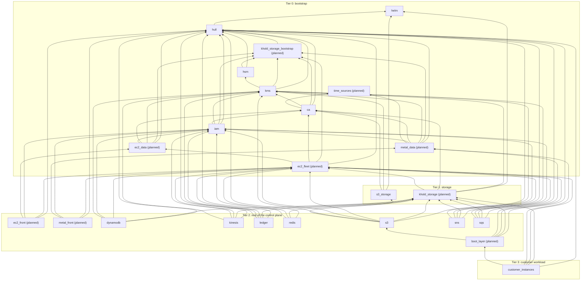

# AZ cold start

How an availability zone comes back after every host lost power at once
(`.kiro/specs/az-cold-start/`). The antikythera half (helm's sealed store,
LKG boot, standing instances and the power-on policy) is
`.kiro/specs/cold-start/` in `bit63-org/antikythera`.

Sections: the start order (generated from the graph), what each phase
looks like when it is healthy and what to do when it is stuck, the time
floor, recovery mode, the break-glass restore, and the real-hardware
drill. Pieces still being built are marked **planned**; until they land,
the step that needs them is done by hand or not at all, as each section
says.

## Start order

Power returns, possibly domain by domain. Each host waits its tier delay
plus its slot and some jitter, measured from its own power-on, then boots.
Tiers are a time ordering plus retries, not gates: a component that starts
before what it needs backs off and tries again, which is what lets the AZ
come back with a tier-0 host dead.

The tables below are the checked order. They are generated from
`config/cold_start_graph.yaml`, which CI checks on every pull request for
cycles, for a component needing a later tier, for a tier-0 component
needing one that cannot restart locally, and for a service module whose
`services/<m>/cold_start.yaml` is missing or disagrees. Change the graph,
then run

```
tools/cold_start_graph/check_cold_start_graph.py --render
```

"Restarts locally" means from state on its own hosts with no controller:
standing records, last-known-good images and sealed keys. "Needs" lists
direct needs only.

<!-- cold-start-graph:begin -->
<!-- Generated from config/cold_start_graph.yaml by
     tools/cold_start_graph/check_cold_start_graph.py --render.
     Do not edit by hand; CI fails when this is stale. -->

### Tier 0: bootstrap

| # | Component | Restarts | Needs | Owner | Notes |
|---|-----------|----------|-------|-------|-------|
| 1 | `helm` | locally | power only | antikythera | Server management controller; applies the power-on policy, boots hull from the last-known-good image and keeps the sealed store |
| 2 | `time_sources` | locally | power only | core | **planned.** At least two local time sources (GNSS or PTP grandmasters, or trusted RTC NTP servers) in different power domains (Requirement 10.1) |
| 3 | `hull` | locally | `helm` | antikythera | Host agent; starts the pinned instances of the standing set with no controller link |
| 4 | `khold_storage_bootstrap` | locally | `hull` | core | **planned.** khold replicas holding the pinned instances' volumes; elect from durable state and honour standing attachments with no controller (Requirement 6) |
| 5 | `hsm` | locally | `hull`, `khold_storage_bootstrap` | `services/hsm` | Virtual HSM in pinned instances; unseals itself from instance secrets (node unseal, Requirement 3.3) |
| 6 | `kms` | locally | `hull`, `khold_storage_bootstrap`, `hsm` | `services/kms` | Key management; unwraps keys through the HSM |
| 7 | `ca` | locally | `hull`, `khold_storage_bootstrap`, `kms`, `time_sources` | core | Certificate authority Raft group (cmd/ca_cluster_node); members use bootstrap identity certificates among themselves (Requirement 9.4) |
| 8 | `iam` | locally | `hull`, `khold_storage_bootstrap`, `kms`, `ca` | `services/iam` | Identity and access management |
| 9 | `ec2_data` | locally | `hull`, `khold_storage_bootstrap`, `kms`, `ca`, `iam` | `services/ec2` | **planned.** EC2 data layer; servers, instances, standing sets and the recovery-mode state |
| 10 | `metal_data` | locally | `hull`, `khold_storage_bootstrap`, `kms`, `ca`, `iam`, `time_sources` | `services/metal` | **planned.** Metal registry data layer; tiers, power domains and slots; commits the time floor every 10 minutes (Requirement 10.2) |
| 11 | `ec2_fleet` | locally | `hull`, `khold_storage_bootstrap`, `ca`, `ec2_data` | `services/ec2` | **planned.** EC2 fleet layer (the controller, with khold's controller library); starts in recovery mode |

### Tier 1: storage

| # | Component | Restarts | Needs | Owner | Notes |
|---|-----------|----------|-------|-------|-------|
| 1 | `s3_storage` | locally | `helm`, `kms`, `ca` | `services/s3` | S3 storage nodes; boot LKG and serve the objects they hold, including the boot layer's images |
| 2 | `khold_storage` | locally | `helm`, `kms`, `ca`, `ec2_fleet` | core | **planned.** khold storage nodes for every other volume; boot LKG and serve the data they hold, with membership from the fleet layer |

### Tier 2: rest of the control plane

| # | Component | Restarts | Needs | Owner | Notes |
|---|-----------|----------|-------|-------|-------|
| 1 | `ec2_front` | by the controller | `hull`, `ec2_fleet`, `iam`, `ec2_data` | `services/ec2` | **planned.** EC2 API front |
| 2 | `metal_front` | by the controller | `hull`, `ec2_fleet`, `iam`, `metal_data` | `services/metal` | **planned.** Metal API front, including DescribeRecovery |
| 3 | `dynamodb` | by the controller | `hull`, `khold_storage`, `ec2_fleet`, `iam`, `kms` | `services/dynamodb` | DynamoDB-compatible tables |
| 4 | `kinesis` | by the controller | `hull`, `khold_storage`, `ec2_fleet`, `iam`, `kms` | `services/kinesis` | Kinesis-compatible streams |
| 5 | `ledger` | by the controller | `hull`, `khold_storage`, `ec2_fleet`, `iam`, `kms` | `services/ledger` | Verifiable ledger |
| 6 | `redis` | by the controller | `hull`, `khold_storage`, `ec2_fleet`, `iam` | `services/redis` | Redis-compatible gateway and build cache |
| 7 | `s3` | by the controller | `hull`, `khold_storage`, `ec2_fleet`, `iam`, `kms`, `s3_storage` | `services/s3` | S3 front and metadata layers |
| 8 | `sns` | by the controller | `hull`, `khold_storage`, `ec2_fleet`, `iam`, `kms` | `services/sns` | SNS-compatible notifications |
| 9 | `sqs` | by the controller | `hull`, `khold_storage`, `ec2_fleet`, `iam`, `kms` | `services/sqs` | SQS-compatible queues |
| 10 | `boot_layer` | by the controller | `hull`, `khold_storage`, `ec2_fleet`, `metal_data`, `s3` | `services/metal` | **planned.** Metal boot layer; netboot for hosts whose image changed or whose LKG is missing (tier-0 and tier-1 hosts boot LKG and do not need it) |

### Tier 3: customer workload

| # | Component | Restarts | Needs | Owner | Notes |
|---|-----------|----------|-------|-------|-------|
| 1 | `customer_instances` | by the controller | `hull`, `khold_storage`, `ec2_fleet`, `metal_data`, `boot_layer` | core | Customer instances; restarted in waves once their hosts report (Requirement 8) |



<!-- cold-start-graph:end -->

## Phases

Times are from the moment power returns to the last of a quorum of
tier-0 hosts. Targets are the reference configuration's (three tier-0
hosts in three power domains, 25 GbE; Requirement 3.6). Each phase
starts when its tier's delay has passed, not when the tier below
reports healthy, so a stuck phase never holds a later tier off; the
later tier's components simply keep retrying (1 s doubling to 30 s).

### Phase 0: power and helm (0 s to about 1 minute)

Healthy:

- Every helm starts within seconds of its power and logs `boot <id>:
  tier T slot S, host released in N ms`. N is about `tier_delay + slot x
  interval + jitter` (defaults 0, 60, 180, 300 s; 5 s slots; up to 2 s
  jitter). `(default policy)` in that line means helm never received a
  policy from the controller and is using tier 3's.
- A helm whose RTC battery died logs `RTC reads ... below the time floor
  ...: not trusted`. That is expected, not a fault: helm checks
  certificates against its stored time floor until the time is set.
- After the wait, `boot: K slot(s) ready, 0 faulted, host released`.

Stuck:

- No helm log at all: the server has no power or helm's management
  controller did not start. Check the PDU and the BMC (or harbor's
  console on simulated hosts).
- `sealed store rolled back` or `degraded (n fault(s))`: the store opened,
  but helm dropped what it could not trust. The host still boots; it
  waits for the controller's next policy and standing set instead of
  using stored ones. Note it for the timeline and carry on.
- `store anchor:` or `sealed store:` errors and helm exits: the anchor
  (TPM or its software stand-in) or the store device is unreadable.
  This host stays down; the AZ comes back without it. Replace or
  re-provision it after recovery.
- A host that powered on at once instead of waiting: its BMC restores
  power by itself. Metal's settings check lists these; fix the BMC
  setting after recovery.

### Phase 1: bootstrap tier (target: serving within 10 minutes)

Healthy, in roughly this order on the tier-0 hosts:

- hull boots from the last-known-good image (**planned**, antikythera
  cold-start task 4; until then hull netboots and this phase needs the
  boot layer) and starts the pinned instances of its standing set
  (**planned**, task 6; until then the operator starts them).
- khold's bootstrap replicas elect from durable state and serve the
  pinned volumes through their standing attachments (**planned**).
- The HSM replicas unseal one another from instance secrets
  (**planned**; until then, operator unseal), then KMS, the CA, IAM and
  the EC2 and metal data layers form their quorums.
- `ca_cluster_node` elects a leader, which commits a time floor at once
  and then every ten minutes (`kythira_time_floor_seconds` rises).

Stuck:

- A group with no leader after its members are up: count the members
  that are actually running. A group needs a majority. If a member's
  host is merely slow, wait. If a member is gone for good, see
  "A group that cannot reach a majority" below; do not change the
  membership by hand.
- The CA answers `503 clock_below_time_floor`: the leader's clock reads
  earlier than a time the cluster has already passed. Set the leader's
  clock (or let NTP from the local time sources set it); issuance
  resumes on the next request. `kythira_clock_below_time_floor_seconds`
  says by how much it is behind.
- `503 clock_ahead_of_time_sources`: the clock is more than five minutes
  ahead of the time sources' median. Correct the clock. (Time sources
  are **planned**; until they are sampled only the floor applies.)
- The HSM stays sealed: unseal it by hand with the operator shares
  (break-glass), then carry on.

### Phase 2: storage and the rest of the control plane (from 1 and 3 minutes)

Healthy:

- S3 storage and khold storage hosts boot their LKG images and serve the
  data they hold as soon as their own groups have quorum, with no
  control plane.
- Tier-2 hosts link to the EC2 controller, which is in recovery mode
  (below), and send their inventories, `cold_start` and `boot_cache`
  reports. The controller restarts the non-pinned control-plane
  instances.

Stuck:

- Hosts link but get no work: check that the EC2 fleet layer is in
  recovery mode and has a leader. Recovery mode withholds silence-driven
  actions, not launches; launches on hosts that reported go ahead.
- A service waits for a dependency that is up: it retries with a cap of
  30 s, so give it a minute; if it is still waiting, its own logs name
  the dependency it cannot reach.

### Phase 3: customer hosts (from 5 minutes)

Healthy:

- Customer hosts link, re-enroll if their certificates expired during
  the outage, and their instances restart in waves with `system-reboot`
  events (**planned**, kythira task 13).
- Recovery mode ends with `hosts_reported` once 95 % of in-service hosts
  have reported.

Stuck:

- Recovery mode ends with `timed_out` after 30 minutes: the hosts in its
  exit event never reported. They go to the ordinary rate-limited
  silence rules, so they are handled slowly; look at each one's power and
  console rather than waiting for the rules.

## The time floor

The time floor is the newest time the bootstrap tier is known to have
passed. The CA cluster's leader commits its clock as the floor every ten
minutes (the metal data layer will commit it too once it exists) (at once after an election), only from a clock that passes the
issuing check, so after an outage of any length the floor is at most ten
minutes behind the moment power was lost. helm keeps the newest floor it
has verified in its sealed store.

A node whose clock reads below the floor refuses to issue certificates,
and helm checks certificates against max(RTC, floor). A floor only
rises; a wrong floor in the future would stop issuance everywhere, which
is why only a clock that passes the check may commit one. If that ever
happens, the fix is to wait until real time passes it or to restore the
CA from a snapshot taken before it (break-glass): there is no command
that lowers it, by design.

## Recovery mode

The EC2 controller, khold's controller library and the metal registry
enter recovery mode when they start with more than 5 % of in-service
hosts unlinked, or when the operator calls `BeginRecovery` for a drill
(**planned**: the controllers are still being built; the shared logic is
`include/raft/recovery_mode.hpp`). While it holds they do not declare
hosts lost, replace replicas, mark status checks impaired for silence,
stop or retire instances, start drains, open enrollment windows
automatically, or change volume layouts except to restore a standing
attachment. They do accept links and inventories, reconcile, renew
certificates, serve reads, and serve launches and attaches on hosts that
reported.

It ends when 95 % of in-service hosts have reported, after 30 minutes,
or on `EndRecovery`. Call `EndRecovery` early only when you know the
remaining hosts are gone for good: from then on silence counts again.

## A group that cannot reach a majority

No group shrinks its membership or replaces a member during recovery
mode. When voters are gone for good (the host is destroyed, not merely
unreachable), recover the group with `RecoverGroupFromSurvivors`
(**planned**), which records which acknowledged writes may be lost and is
refused while any lost voter's host is still only unreachable. If the
bootstrap tier itself cannot form quorums, use the break-glass restore.

## Break-glass restore

For when the bootstrap tier cannot come back on its own hosts
(Requirement 12; the tool is **planned**):

1. Confirm a quorum of the original bootstrap tier is really unreachable:
   the restore refuses to run otherwise, so two control planes never
   exist at once.
2. Bring up the seed machines outside the fleet (the metal seed path) or
   pick a neighbouring AZ's control plane.
3. Run `kythira-coldstart restore` with the newest hourly snapshot from
   the out-of-AZ store. It needs the break-glass key holders to unwrap
   the snapshot key and the operator shares to unseal the HSM.
4. Read its report of what changed after that snapshot and may be lost,
   and keep it with the incident.
5. The restored tier signs fresh standing sets for the tier-0 hosts; the
   rest of the AZ then comes back as above.
6. Afterwards, move the control plane back from the seed onto pinned
   instances with the services' layer migrations.

## Real-hardware drill

Cutting power to every host of the home-lab AZ is the only test of the
real power domains, BMCs and drives. It runs only when Clark says go, in
his own words, at most once a month (Requirement 14.4).

Before:

1. Note the date of the last drill; skip if it was less than a month ago.
2. Check that the hourly bootstrap snapshots are current and that the
   break-glass key holders and operator shares are reachable.
3. Check every tier-0 host's helm holds a power-on policy (`boot_cache`
   reports show `policy_version` non-zero) and, once task 6 lands, a
   current standing set.
4. Start a clock and a notes file for the timeline.

During:

1. Cut power at the PDUs for every power domain at once.
2. Wait at least two minutes, longer than every component's shutdown.
3. Restore power, domain by domain in a random order if the drill calls
   for it.
4. Record, for each phase above, when it started and when it was
   healthy, against the targets. `DescribeRecovery` (**planned**) gives
   these per tier; until then, take them from helm's logs, the
   controllers' recovery-mode events and each service's first served
   request.

After:

1. Check: no acknowledged write lost (the services' consistency
   checkers), every instance that was running is running, recovery mode
   was entered and left, and no silence-driven action ran during it.
2. Keep the timeline and any stuck phase with the drill results, and
   open a task for each deviation from the targets.
