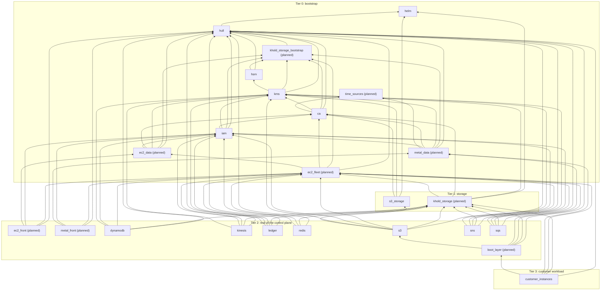

# AZ cold start

How an availability zone comes back after every host lost power at once
(`.kiro/specs/az-cold-start/`). The antikythera half (helm's sealed store,
LKG boot, standing instances and the power-on policy) is
`.kiro/specs/cold-start/` in `bit63-org/antikythera`.

This runbook grows with the spec: task 18 adds what each phase looks like
when healthy, what to do when one is stuck, and the break-glass restore.

## Start order

Power returns, possibly domain by domain. Each host waits its tier delay
plus its slot and some jitter, measured from its own power-on, then boots.
Tiers are a time ordering plus retries, not gates: a component that starts
before what it needs backs off and tries again, which is what lets the AZ
come back with a tier-0 host dead.

The tables below are the checked order. They are generated from
`config/cold_start_graph.yaml`, which CI checks on every pull request for
cycles, for a component needing a later tier, for a tier-0 component
needing one that cannot restart locally, and for a service module whose
`services/<m>/cold_start.yaml` is missing or disagrees. Change the graph,
then run

```
tools/cold_start_graph/check_cold_start_graph.py --render
```

"Restarts locally" means from state on its own hosts with no controller:
standing records, last-known-good images and sealed keys. "Needs" lists
direct needs only.

<!-- cold-start-graph:begin -->
<!-- Generated from config/cold_start_graph.yaml by
     tools/cold_start_graph/check_cold_start_graph.py --render.
     Do not edit by hand; CI fails when this is stale. -->

### Tier 0: bootstrap

| # | Component | Restarts | Needs | Owner | Notes |
|---|-----------|----------|-------|-------|-------|
| 1 | `helm` | locally | power only | antikythera | Server management controller; applies the power-on policy, boots hull from the last-known-good image and keeps the sealed store |
| 2 | `time_sources` | locally | power only | core | **planned.** At least two local time sources (GNSS or PTP grandmasters, or trusted RTC NTP servers) in different power domains (Requirement 10.1) |
| 3 | `hull` | locally | `helm` | antikythera | Host agent; starts the pinned instances of the standing set with no controller link |
| 4 | `khold_storage_bootstrap` | locally | `hull` | core | **planned.** khold replicas holding the pinned instances' volumes; elect from durable state and honour standing attachments with no controller (Requirement 6) |
| 5 | `hsm` | locally | `hull`, `khold_storage_bootstrap` | `services/hsm` | Virtual HSM in pinned instances; unseals itself from instance secrets (node unseal, Requirement 3.3) |
| 6 | `kms` | locally | `hull`, `khold_storage_bootstrap`, `hsm` | `services/kms` | Key management; unwraps keys through the HSM |
| 7 | `ca` | locally | `hull`, `khold_storage_bootstrap`, `kms`, `time_sources` | core | Certificate authority Raft group (cmd/ca_cluster_node); members use bootstrap identity certificates among themselves (Requirement 9.4) |
| 8 | `iam` | locally | `hull`, `khold_storage_bootstrap`, `kms`, `ca` | `services/iam` | Identity and access management |
| 9 | `ec2_data` | locally | `hull`, `khold_storage_bootstrap`, `kms`, `ca`, `iam` | `services/ec2` | **planned.** EC2 data layer; servers, instances, standing sets and the recovery-mode state |
| 10 | `metal_data` | locally | `hull`, `khold_storage_bootstrap`, `kms`, `ca`, `iam`, `time_sources` | `services/metal` | **planned.** Metal registry data layer; tiers, power domains and slots; commits the time floor every 10 minutes (Requirement 10.2) |
| 11 | `ec2_fleet` | locally | `hull`, `khold_storage_bootstrap`, `ca`, `ec2_data` | `services/ec2` | **planned.** EC2 fleet layer (the controller, with khold's controller library); starts in recovery mode |

### Tier 1: storage

| # | Component | Restarts | Needs | Owner | Notes |
|---|-----------|----------|-------|-------|-------|
| 1 | `s3_storage` | locally | `helm`, `kms`, `ca` | `services/s3` | S3 storage nodes; boot LKG and serve the objects they hold, including the boot layer's images |
| 2 | `khold_storage` | locally | `helm`, `kms`, `ca`, `ec2_fleet` | core | **planned.** khold storage nodes for every other volume; boot LKG and serve the data they hold, with membership from the fleet layer |

### Tier 2: rest of the control plane

| # | Component | Restarts | Needs | Owner | Notes |
|---|-----------|----------|-------|-------|-------|
| 1 | `ec2_front` | by the controller | `hull`, `ec2_fleet`, `iam`, `ec2_data` | `services/ec2` | **planned.** EC2 API front |
| 2 | `metal_front` | by the controller | `hull`, `ec2_fleet`, `iam`, `metal_data` | `services/metal` | **planned.** Metal API front, including DescribeRecovery |
| 3 | `dynamodb` | by the controller | `hull`, `khold_storage`, `ec2_fleet`, `iam`, `kms` | `services/dynamodb` | DynamoDB-compatible tables |
| 4 | `kinesis` | by the controller | `hull`, `khold_storage`, `ec2_fleet`, `iam`, `kms` | `services/kinesis` | Kinesis-compatible streams |
| 5 | `ledger` | by the controller | `hull`, `khold_storage`, `ec2_fleet`, `iam`, `kms` | `services/ledger` | Verifiable ledger |
| 6 | `redis` | by the controller | `hull`, `khold_storage`, `ec2_fleet`, `iam` | `services/redis` | Redis-compatible gateway and build cache |
| 7 | `s3` | by the controller | `hull`, `khold_storage`, `ec2_fleet`, `iam`, `kms`, `s3_storage` | `services/s3` | S3 front and metadata layers |
| 8 | `sns` | by the controller | `hull`, `khold_storage`, `ec2_fleet`, `iam`, `kms` | `services/sns` | SNS-compatible notifications |
| 9 | `sqs` | by the controller | `hull`, `khold_storage`, `ec2_fleet`, `iam`, `kms` | `services/sqs` | SQS-compatible queues |
| 10 | `boot_layer` | by the controller | `hull`, `khold_storage`, `ec2_fleet`, `metal_data`, `s3` | `services/metal` | **planned.** Metal boot layer; netboot for hosts whose image changed or whose LKG is missing (tier-0 and tier-1 hosts boot LKG and do not need it) |

### Tier 3: customer workload

| # | Component | Restarts | Needs | Owner | Notes |
|---|-----------|----------|-------|-------|-------|
| 1 | `customer_instances` | by the controller | `hull`, `khold_storage`, `ec2_fleet`, `metal_data`, `boot_layer` | core | Customer instances; restarted in waves once their hosts report (Requirement 8) |



<!-- cold-start-graph:end -->
